<p align="center">
  
</p>

<p align="center">
  <strong>An original Android launcher project for Minecraft: Java Edition.</strong><br>
  Built around a clean experience, modular architecture, and a distinct VEYRON identity.
</p>

<p align="center">
  
</p>

<p align="center">
  
  
  
  
</p>

<p align="center">
  <a href="https://github.com/Raze78672/VEYRON-Launcher/issues">Report a bug</a>
  ·
  <a href="https://github.com/Raze78672/VEYRON-Launcher/issues">Request a feature</a>
</p>

<p align="center"></p>

## About VEYRON Launcher

**VEYRON Launcher** is an independent Android launcher project being designed to install, manage, and run legitimate copies of **Minecraft: Java Edition** on compatible Android devices.

The goal is to create a complete launcher experience—not just a visual interface. The project is planned around its own application code, interface, account flow, installation manager, and modular runtime/rendering integration.

> **Project status:** Early development. The repository is being established and the implementation roadmap is being defined. Features listed below are planned unless explicitly marked otherwise.

<p align="center"></p>

## Vision

- **A native Android experience** — designed for touch controls and landscape gameplay.
- **A distinctive identity** — VEYRON's own visual language, navigation, and interaction design.
- **A modular foundation** — keep authentication, installation, runtime, rendering, and UI concerns separate.
- **A responsible account flow** — use supported Microsoft sign-in methods and protect session data.
- **A maintainable codebase** — prioritize clear modules, testable components, and documented decisions.

## Planned features

| Area | Planned capabilities |
|---|---|
| Accounts | Microsoft sign-in, account profiles, account switching, session refresh |
| Game versions | Browse, install, update, and manage Minecraft versions |
| Mod loaders | Fabric, Forge, and NeoForge integration where compatible |
| Downloads | Progress tracking, retry/resume, and file verification |
| Java runtime | Runtime selection and version compatibility checks |
| Game launch | Prepare launch arguments and start the game through an Android-compatible runtime layer |
| Mod management | Browse and manage compatible mods and modpacks |
| Customization | Resource packs, shaders, themes, and home backgrounds |
| Diagnostics | Game logs, installation details, and crash information |

Feature availability will depend on Minecraft version compatibility, Android device capabilities, and the licensing and requirements of each dependency.

<p align="center"></p>

## Technology direction

| Component | Planned technology |
|---|---|
| Primary language | Java |
| Android interface | Android Views, XML, and Fragments |
| Build system | Gradle |
| Authentication | Microsoft OAuth 2.0 authorization code flow with PKCE |
| Local protection | Android Keystore-backed token protection |
| Game metadata | Official Minecraft version metadata |
| Runtime integration | Modular Android-compatible Java runtime |
| Rendering | Pluggable Android-compatible rendering layer |

The renderer and runtime integration are major engineering tasks. Desktop Minecraft cannot be assumed to run on Android unchanged; compatible graphics, input, audio, and native-library support must be integrated and tested.

## Architecture

The codebase is intended to grow into clearly separated modules:

```text
VEYRON-Launcher/
├── app/                  # Android application and navigation
├── ui/                   # Screens, components, themes, adapters
├── auth/
│   ├── microsoft/        # Microsoft sign-in
│   ├── xbox/             # Xbox token exchange
│   └── minecraft/        # Minecraft profile and entitlement checks
├── launcher-core/        # Launcher orchestration and models
├── version-manager/      # Version metadata and installations
├── download-manager/     # Downloads, retries, integrity checks
├── runtime/              # Java runtime management
├── game/                 # Launch preparation and game lifecycle
├── renderer/             # Renderer abstraction and integrations
├── features/
│   ├── mods/
│   ├── modpacks/
│   ├── resourcepacks/
│   ├── shaders/
│   └── worlds/
├── storage/              # Local configuration and persistence
├── assets/               # Branding and visual assets
└── docs/                 # Technical documentation
```

This is the intended structure; modules will be added as implementation progresses.

<p align="center"></p>

## Development roadmap

- [ ] **Foundation** — Android project setup, Gradle configuration, navigation, theme, and storage.
- [ ] **Account system** — Microsoft OAuth with PKCE, Xbox/XSTS exchange, Minecraft profile and entitlement checks.
- [ ] **Version installer** — version manifest, metadata, libraries, assets, and integrity verification.
- [ ] **Runtime layer** — compatible Java runtime management and device checks.
- [ ] **Game launch** — launch preparation, renderer integration, input, audio, and lifecycle handling.
- [ ] **Mod ecosystem** — compatible loader, mod, and modpack management.
- [ ] **Polish and diagnostics** — crash reports, logs, accessibility, and performance testing.

## Security and account handling

VEYRON Launcher will not ask users to enter their Microsoft password into an in-app custom form. The planned account flow uses Microsoft's supported authorization experience and a native-app PKCE flow.

Authentication tokens are sensitive. They must not be committed to the repository, printed in logs, or stored as plain text. Account and entitlement checks are not intended to bypass Minecraft ownership requirements.

## Project principles

1. Original VEYRON application code and interface.
2. Use legitimate game files and respect the relevant Minecraft and Microsoft terms.
3. Keep third-party libraries and integrations properly attributed and licensed.
4. Never commit credentials, access tokens, signing keys, or personal account data.
5. Be transparent about what is implemented, experimental, or still planned.

## Contributing

The project is at an early stage. Once the initial source structure and contribution guidelines are in place, contribution instructions will be published here.

For now, use [GitHub Issues](https://github.com/Raze78672/VEYRON-Launcher/issues) to report a problem or suggest an improvement.

## Disclaimer

VEYRON Launcher is an independent community project and is not an official Minecraft, Mojang, Microsoft, or Xbox product. Minecraft is a trademark of its respective owner. This project is not affiliated with, endorsed by, or sponsored by Mojang or Microsoft.

<p align="center">
  
</p>
